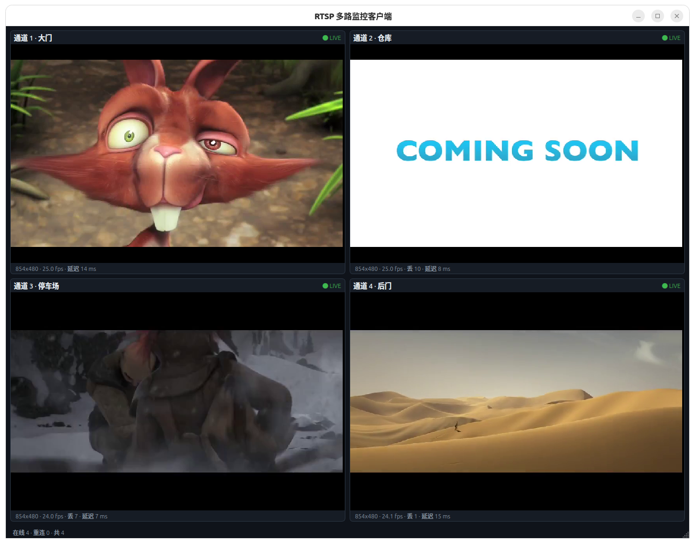

# RTSP Monitor

**多路 RTSP 实时视频监控客户端** · C++17 / FFmpeg / Qt6 / Linux




## 项目简介

RTSP Monitor 是一个 Linux 桌面客户端，用于同时预览多路 IP 摄像头。每路拥有独立解码线程和帧队列，界面线程只取最新帧，连接中断后自动重连。

项目面向实时监控场景，优先保证画面新鲜度和连接可用性。

## 功能

- 多路 RTSP 或本地视频预览，通道数由配置决定，最高验证 9 路
- 每路一个独立解码线程，单路断流或卡顿不影响其他通道
- 容量 3 的有界帧队列：队列满时丢弃最旧帧，UI 每 20ms 非阻塞取最新帧
- RTSP over TCP，连接和读包各 5 秒超时
- 通过 `AVIOInterruptCB` 打断阻塞 I/O，退出时无需等待网络超时
- 指数退避重连：1 / 2 / 4 / 8 / 10 秒，等待可 100ms 内中断，稳定 15 秒后重置
- 重连后等待关键帧再解码，避免首帧花屏
- 每路输出 FPS、取帧延迟、丢帧、重连次数与恢复耗时

## 架构

```
┌──────────────────────────── UI 线程 ────────────────────────────┐
│ MainWindow / ChannelTile / VideoWidget                          │
│ QTimer(20ms) → tryPopLatest() → QImage/QPainter 绘制             │
└───────────────────────▲─────────────────────────────────────────┘
                        │ 每路一个容量 3 的有界帧队列（满丢最旧）
┌───────────────────────┴─────────────────────────────────────────┐
│ 每路一个 DecodeWorker（独立线程）                                 │
│  VideoDecoder（FFmpeg） → Frame(RGB)                             │
│  超时 / 退避重连 / 关键帧等待                                     │
└───────────────────────▲─────────────────────────────────────────┘
                        │ RTSP / RTP over TCP
┌───────────────────────┴─────────────────────────────────────────┐
│ 摄像头 / NVR / 本地测试文件                                       │
└─────────────────────────────────────────────────────────────────┘
```

- UI 线程只处理事件、绘制和非阻塞取帧，不调用阻塞的 FFmpeg 接口；
- 解码线程负责打开、读包、解码和重连；
- 共享状态仅有每路的有界帧队列，以及原子停止/超时标志。

## 技术栈

| 类别 | 使用 |
|---|---|
| 语言 | C++17 |
| 音视频 | FFmpeg 7.1（libavformat / libavcodec / libswscale / libavutil） |
| UI | Qt 6 Widgets |
| 并发 | `std::thread`、`std::mutex`、`std::condition_variable`、`std::atomic` |
| 网络/协议 | TCP/IP、RTSP、RTP over TCP |
| 构建/调试 | Makefile、G++、GDB、ASan |

## 构建

验证环境：

| 组件 | 版本 |
|---|---|
| 操作系统 | Ubuntu 25.10 |
| 编译器 | g++ 15.2.0（C++17） |
| UI | Qt 6.9.2（Widgets） |
| FFmpeg | 7.1.1（libavformat 61 / libavcodec 61 / libswscale 8 / libavutil 59） |

```bash
sudo apt install build-essential pkg-config qt6-base-dev \
                 libavformat-dev libavcodec-dev libswscale-dev libavutil-dev

make
```

生成可执行文件 `./rtsp_monitor`。

## 使用

```bash
# 读取 config/channels.json
./rtsp_monitor

# 命令行指定输入，参数个数不限
./rtsp_monitor media/gate.mp4 media/warehouse.mp4 media/parking.mp4 media/backdoor.mp4
./rtsp_monitor rtsp://127.0.0.1:8554/gate
```

程序从可执行文件所在目录读取 `config/channels.json`；配置中的本地相对路径按配置文件目录解析。

### 本地 RTSP 测试流

使用 [mediamtx](https://github.com/bluenviron/mediamtx) 提供 RTSP 服务：

```bash
mediamtx

ffmpeg -re -stream_loop -1 -i media/gate.mp4 -an -c copy -f rtsp rtsp://127.0.0.1:8554/gate
ffmpeg -re -stream_loop -1 -i media/warehouse.mp4 -an -c copy -f rtsp rtsp://127.0.0.1:8554/warehouse
ffmpeg -re -stream_loop -1 -i media/parking.mp4 -an -c copy -f rtsp rtsp://127.0.0.1:8554/parking
ffmpeg -re -stream_loop -1 -i media/backdoor.mp4 -an -c copy -f rtsp rtsp://127.0.0.1:8554/backdoor
```

随后运行 `./rtsp_monitor`，默认配置会连接上述四个路径。

## 配置

`config/channels.json`：

```json
{
  "channels": [
    { "name": "通道 1 · 大门",   "url": "rtsp://127.0.0.1:8554/gate" },
    { "name": "通道 2 · 仓库",   "url": "rtsp://127.0.0.1:8554/warehouse" },
    { "name": "通道 3 · 停车场", "url": "rtsp://127.0.0.1:8554/parking" },
    { "name": "通道 4 · 后门",   "url": "rtsp://127.0.0.1:8554/backdoor" }
  ]
}
```

- `name`：界面标题，留空时自动生成；
- `url`：RTSP 地址或本地文件路径；
- 相对路径按配置文件所在目录解析。

## 测试

```bash
make test
make asan-tests
```

当前包含三个单元测试，覆盖帧队列、解码器和解码线程。

## 性能

测试环境：2 vCPU / 3.3 GB Ubuntu 虚拟机，854×480@25fps，软件解码，offscreen 渲染。CPU 为整机双核占用；延迟为解码完成到 UI 取帧，不含网络。

| 场景 | CPU | 内存 | 解码到显示延迟 |
|---|---|---|---|
| 4 路，30 秒 | 27% | 113 MB | 11.9 ms |
| 9 路，15 秒 | 57% | 181 MB | 14.2 ms |

- 4 路连续运行 5 分钟，内存稳定在约 110 MB；
- 停掉一路源 6 秒后重新推流，恢复推流后约 2 秒重连成功，其余通道不受影响。

实时统计：

```bash
RTSP_MONITOR_STATS=1 ./rtsp_monitor
```

每秒每路输出 FPS、取帧延迟、丢帧数、重连次数和恢复耗时到 stderr。

## 目录结构

```
src/main.cpp       程序入口
src/core/          解码器、帧队列、解码线程、配置结构体、运行统计
src/ui/            Qt 窗口、通道卡片、视频控件、配置读取
tests/             单元测试
config/            通道配置
media/             开放授权测试视频
```

## 许可证

代码使用 MIT License。

`media/` 中的视频截取自 Blender Foundation 开源电影，授权信息见 [media/README.md](media/README.md)。
